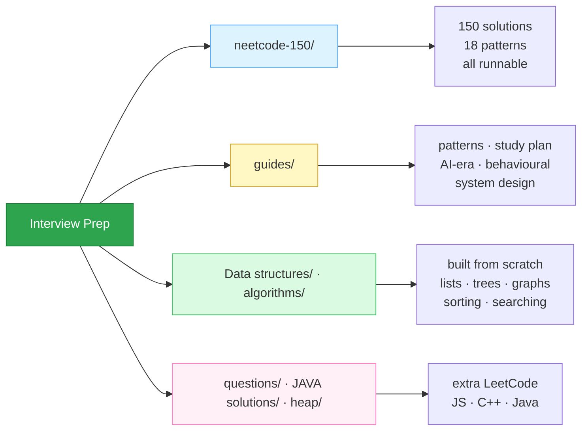

<div align="center">

# Interview Prep

**Data structures, algorithms, and the complete NeetCode 150 — every solution runnable, tested, and explained.**

[](SOLUTIONS.md)
[](neetcode-150/README.md)
[](https://github.com/Saif64/Interview-prep/actions/workflows/ci.yml)
[](SOLUTIONS.md)
[](LICENSE)
[](CONTRIBUTING.md)

[**Start here**](#-where-to-start) · [**NeetCode 150**](neetcode-150/README.md) · [**All solutions**](SOLUTIONS.md) · [**The 18 patterns**](guides/patterns.md) · [**Interviewing in the AI era**](guides/ai-era-interviews.md)

</div>

---

Every solution in `neetcode-150/` runs its own assertions. No framework, no setup, no
`npm install` — just Node:

```bash
node neetcode-150/01-arrays-and-hashing/0001-two-sum.js
# 1 ok
```

Open any file and you get the same three things: **why the approach works**, the
**complexity**, and the **edge cases that break the naive version** — written as tests you
can run and break yourself.

---

## 🚀 Where to start

| You have | Do this |
| :--- | :--- |
| **A week** | The ⭐ [Blind 75 subset](neetcode-150/README.md) — 75 problems, highest signal per hour |
| **A month** | The full [NeetCode 150](neetcode-150/README.md), one pattern at a time |
| **Longer** | The 150 + [the study plan](guides/study-plan.md) + a project worth talking about |
| **An interview tomorrow** | [The 18 patterns](guides/patterns.md) — recognition beats recall |
| **Anxiety about AI** | [Interviewing when the machine can already solve it](guides/ai-era-interviews.md) |

```bash
git clone https://github.com/Saif64/Interview-prep.git
cd Interview-prep

node tools/test.js              # run all 151 checks
node tools/test.js trees        # run one pattern
node tools/test.js 0015         # run one problem
```

Requires Node 18+. Nothing else.

---

## 📚 What's in here



### [`neetcode-150/`](neetcode-150/README.md) — the structured path

All 150 problems from [neetcode.io](https://neetcode.io/practice), grouped by pattern,
solved in JavaScript with the reasoning written out.

| | Pattern | | | Pattern | |
| :-: | :--- | --: | :-: | :--- | --: |
| 1 | [Arrays & Hashing](neetcode-150/01-arrays-and-hashing) | 9 | 10 | [Backtracking](neetcode-150/10-backtracking) | 9 |
| 2 | [Two Pointers](neetcode-150/02-two-pointers) | 5 | 11 | [Graphs](neetcode-150/11-graphs) | 13 |
| 3 | [Sliding Window](neetcode-150/03-sliding-window) | 6 | 12 | [Advanced Graphs](neetcode-150/12-advanced-graphs) | 6 |
| 4 | [Stack](neetcode-150/04-stack) | 7 | 13 | [1-D DP](neetcode-150/13-1-d-dynamic-programming) | 12 |
| 5 | [Binary Search](neetcode-150/05-binary-search) | 7 | 14 | [2-D DP](neetcode-150/14-2-d-dynamic-programming) | 11 |
| 6 | [Linked List](neetcode-150/06-linked-list) | 11 | 15 | [Greedy](neetcode-150/15-greedy) | 8 |
| 7 | [Trees](neetcode-150/07-trees) | 15 | 16 | [Intervals](neetcode-150/16-intervals) | 6 |
| 8 | [Tries](neetcode-150/08-tries) | 3 | 17 | [Math & Geometry](neetcode-150/17-math-and-geometry) | 8 |
| 9 | [Heap / Priority Queue](neetcode-150/09-heap-priority-queue) | 7 | 18 | [Bit Manipulation](neetcode-150/18-bit-manipulation) | 7 |

### [`guides/`](guides) — the parts that aren't code

| Guide | What it's for |
| :--- | :--- |
| [**The 18 patterns**](guides/patterns.md) | Recognise the shape in two minutes. The most useful page here. |
| [**Interviewing in the AI era**](guides/ai-era-interviews.md) | What the interview measures now, and how to answer "do you use AI?" |
| [**Study plans**](guides/study-plan.md) | 1 week / 4 weeks / 3 months, with what to cut when time runs out |
| [**The behavioural round**](guides/behavioral.md) | Six stories that cover thirty questions |
| [**System design**](guides/system-design.md) | The minimum map, including designing systems that use models |

### [`SOLUTIONS.md`](SOLUTIONS.md) — every solution, indexed

**193 problems** across JavaScript, C++ and Java, cross-linked when a problem is solved in
more than one. Generated from the repo, so it never goes stale.

| 🟩 Easy | 🟨 Medium | 🟥 Hard |
| :-----: | :-------: | :-----: |
| 51 | 116 | 26 |

### The from-scratch implementations

`Data structures/` and `algorithms/` hold the things built from nothing — linked lists,
trees, graphs, heaps, sorting, searching, Big-O demonstrations. Start here if you want to
understand *why* a hash map is O(1) before you use one to solve Two Sum.

---

## 🧠 How to use this repo

Reading solutions is the least useful thing you can do with them. The loop that works:

1. **Solve it yourself first**, badly if necessary. The brute force counts.
2. **State the complexity out loud** before checking. Being wrong here is the most useful
   signal you get.
3. **Find the bottleneck**, then name the pattern that removes it. Rescanning → hash map.
   Recomputing → memoise. This step *is* the skill.
4. **Now** open the solution here and compare reasoning, not syntax.
5. **Re-solve it from scratch in three days.** Non-negotiable.

Each file is written to support step 4 — the comment at the top explains the idea and names
the trap, and the assertions at the bottom encode the edge cases:

```js
// 424. Longest Repeating Character Replacement — Medium
// Time O(n) | Space O(1)
//
// Idea: a window is legal when (its length - count of its most common character) <= k.
// `maxCount` is deliberately never decreased: the answer only grows, so a stale high
// value can never produce a longer-than-real result.
```

---

## 🤝 Contributing

PRs are welcome, and there is plenty to do — the 150 are solved in JavaScript only, so
**Python, Java, C++, Go and Rust ports are all open**.

See [CONTRIBUTING.md](CONTRIBUTING.md) for the file format and the one rule: **a solution
must run and pass its own assertions.** CI checks it.

Good first contributions:

- Port a pattern folder to your language
- Add an alternative approach to an existing problem (with the trade-off explained)
- Improve an explanation that didn't click for you
- Fix a typo — genuinely, they all help

<a href="https://github.com/Saif64/Interview-prep/graphs/contributors"></a>

---

## 📺 Worth watching

- [Abdul Bari — Algorithms](https://www.youtube.com/playlist?list=PLDN4rrl48XKpZkf03iYFl-O29szjTrs_O) — the best algorithms explanations on YouTube
- [NeetCode](https://www.youtube.com/@NeetCode) — a walkthrough for every problem in `neetcode-150/`
- [Kunal Kushwaha — DSA](https://www.youtube.com/playlist?list=PL9gnSGHSqcnr_DxHsP7AW9ftq0AtAyYqJ) — long-form, from the beginning
- [HashMaps Level 1](https://www.youtube.com/playlist?list=PL-Jc9J83PIiHq5rMZasunIR19QG3E-PAA) · [Level 2](https://www.youtube.com/playlist?list=PL-Jc9J83PIiEp9DKNiaQyjuDeg3XSoVMR)

Also in [`cheatsheets and more/`](cheatsheets%20and%20more): Big-O posters, a LeetCode
cheatsheet, and interview mind maps.

---

<div align="center">

**If this helped, a ⭐ helps someone else find it.**

Questions, corrections, or something that didn't make sense —
[open an issue](https://github.com/Saif64/Interview-prep/issues).

Built by [Muntasir Mahmud Saif](https://github.com/Saif64) ·
[LinkedIn](https://www.linkedin.com/in/muntasir-mahmud-saif-9a0900233/) ·
[LeetCode](https://leetcode.com/mmSaif_64/)

</div>
