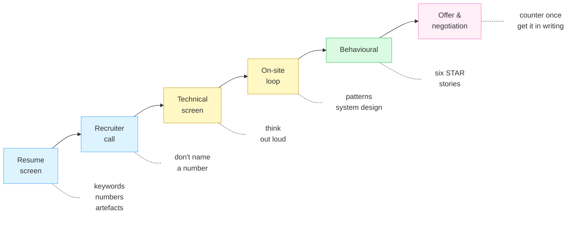

<div align="center">

# Interview Prep

**Everything between "I should start applying" and "I signed the offer."**

The resume that gets the call, the rounds in the middle, the negotiation at the end —
and 150 practice problems with the reasoning written out.

[](#-the-interview)
[](SOLUTIONS.md)
[](neetcode-150/kotlin)
[](https://github.com/Saif64/Interview-prep/actions/workflows/ci.yml)
[](LICENSE)
[](CONTRIBUTING.md)

[**Start here**](#-start-here) · [**The interview**](#-the-interview) · [**Practice**](#-practice) · [**AI-era interviewing**](guides/ai-era-interviews.md)

</div>

---

Most interview repos are a pile of solutions. Solutions are the easy part — a model can write
every one of them in seconds. What actually decides offers is the stuff around them: whether
your resume gets read, whether you can think out loud, whether you know what a round is
measuring, and whether you negotiate at the end.

**So this repo is organised around the interview, not around the problem list.**

---

## 🧭 Start here

Where are you in the process right now?

| Right now | Read this |
| :--- | :--- |
| **Not applied yet** | [The process, end to end](guides/the-process.md) → [Resume](guides/resume.md) |
| **Applications are out** | [Study plans](guides/study-plan.md) → [The 18 patterns](guides/patterns.md) |
| **Loop is next week** | [The coding round, minute by minute](guides/coding-interview-playbook.md) → [Practise out loud](guides/mock-interviews.md) |
| **Interview is tomorrow** | [The 18 patterns](guides/patterns.md) — recognition beats recall |
| **Offer in hand** | [Negotiation](guides/negotiation.md) — do not accept on the call |
| **Worried AI made this pointless** | [Interviewing when the machine can already solve it](guides/ai-era-interviews.md) |
| **Interviewing for Android** | [The Android / Kotlin interview](guides/android-kotlin.md) |

---

## 🗺️ The pipeline

Each stage filters for something different, and most people only prepare for one of them.



---

## 📋 The interview

### Getting in the door

| Guide | What it covers |
| :--- | :--- |
| [**The process, end to end**](guides/the-process.md) | Every stage, what it filters for, where people lose offers they should have won |
| [**Resume**](guides/resume.md) | The bullet formula, why ATS parsers reject good resumes, what to cut |

### The rounds

| Guide | What it covers |
| :--- | :--- |
| [**The 18 patterns**](guides/patterns.md) | Recognise the shape of a problem in two minutes. The most useful page here. |
| [**The coding round, minute by minute**](guides/coding-interview-playbook.md) | What to do with the 45 minutes, and what the rubric actually scores |
| [**Interviewing in the AI era**](guides/ai-era-interviews.md) | AI-allowed rounds, code-comprehension rounds, and how to answer "do you use AI?" |
| [**System design**](guides/system-design.md) | The 45-minute shape, the concepts, and designing systems that use models |
| [**The Android / Kotlin interview**](guides/android-kotlin.md) | Coroutines, Compose stability, lifecycle, mobile system design |
| [**The behavioural round**](guides/behavioral.md) | Six stories that cover thirty questions |

### Getting good, and getting paid

| Guide | What it covers |
| :--- | :--- |
| [**Practise out loud**](guides/mock-interviews.md) | The highest-value habit almost nobody builds deliberately |
| [**Study plans**](guides/study-plan.md) | 1 week / 4 weeks / 3 months, including what to cut when time runs out |
| [**Negotiation**](guides/negotiation.md) | Don't name a number first. Don't accept on the call. What else is negotiable. |
| [**Resources**](guides/resources.md) | A short, opinionated list — books, platforms, mocks, comp data |

---

## 💻 Practice

Practice is one input to interviewing, not the whole thing — but you do still have to do it.

### [NeetCode 150](neetcode-150/README.md)

The 150 problems from [neetcode.io](https://neetcode.io/practice), grouped into 18 patterns,
in **Kotlin** and **JavaScript**. Every solution explains *why* the approach works and names
the trap, and every one runs its own assertions:

```bash
node tools/test.js          # the JavaScript suite
node tools/test-kotlin.js   # the Kotlin suite
```

Open any file and you get the idea, the complexity, and the edge cases that break the naive
version — written as tests you can run and break yourself:

```kotlin
// 424. Longest Repeating Character Replacement — Medium
// Time O(n) | Space O(1)
//
// Idea: a window is legal when (length - count of its most common character) <= k.
// `maxCount` is deliberately never decreased: the answer only grows, so a stale high
// value can never produce a longer-than-real result.
```

### [Every solution, indexed](SOLUTIONS.md)

**193 problems** across Kotlin, JavaScript, C++ and Java, cross-linked when a problem is
solved in more than one. Generated from the repo, so it never goes stale.

| 🟩 Easy | 🟨 Medium | 🟥 Hard |
| :-----: | :-------: | :-----: |
| 51 | 116 | 26 |

### Foundations

`Data structures/` and `algorithms/` hold the things built from nothing — linked lists, trees,
graphs, heaps, sorting, searching, Big-O demonstrations. Start here if you want to understand
*why* a hash map is O(1) before using one to solve Two Sum.

---

## 🧠 How to practise so it transfers

Reading solutions is the least useful thing you can do with them.

1. **Solve it yourself first**, badly if necessary. The brute force counts.
2. **State the complexity out loud** before checking. Being wrong here is the most useful
   signal you get.
3. **Find the bottleneck**, then name the pattern that removes it. Rescanning → hash map.
   Recomputing → memoise. This step *is* the skill.
4. **Then** open the solution here and compare reasoning, not syntax.
5. **Re-solve it from scratch in three days.** Non-negotiable.

If you are doing this at a desk in silence, you are practising the wrong half — see
[Practise out loud](guides/mock-interviews.md).

---

## 🤝 Contributing

PRs welcome. The 150 are solved in Kotlin and JavaScript, so **Python, Java, Go, Swift and
Rust ports are all open** — and so is anything that improves the guides.

See [CONTRIBUTING.md](CONTRIBUTING.md). The one rule: **a solution must run and pass its own
assertions.** CI checks it.

Good first contributions:

- Port a pattern folder to your language
- Add a section to a guide from your own interview experience
- Improve an explanation that didn't click for you
- Fix a typo — genuinely, they all help

<a href="https://github.com/Saif64/Interview-prep/graphs/contributors"></a>

---

<div align="center">

**If this helped, a ⭐ helps someone else find it.**

Something unclear, wrong, or missing —
[open an issue](https://github.com/Saif64/Interview-prep/issues).

Built by [Muntasir Mahmud Saif](https://github.com/Saif64) ·
[LinkedIn](https://www.linkedin.com/in/muntasir-mahmud-saif-9a0900233/) ·
[LeetCode](https://leetcode.com/mmSaif_64/)

</div>
